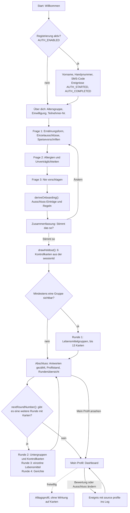
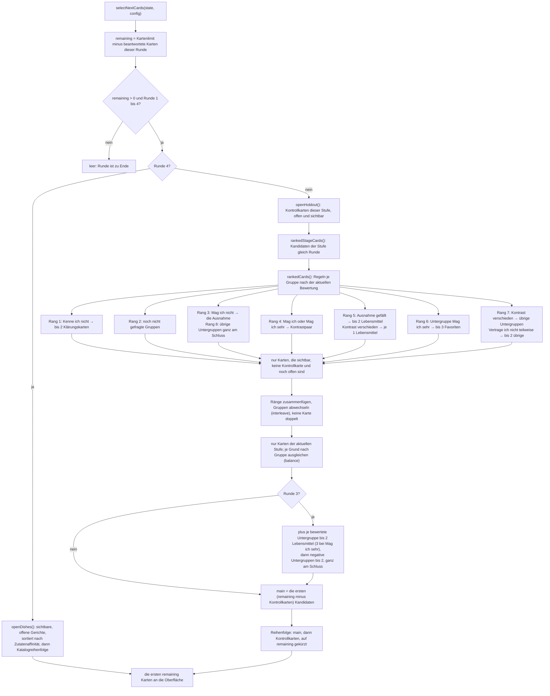
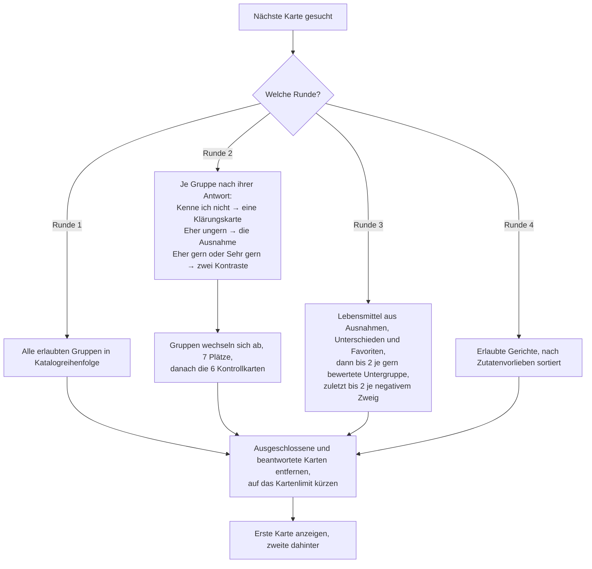
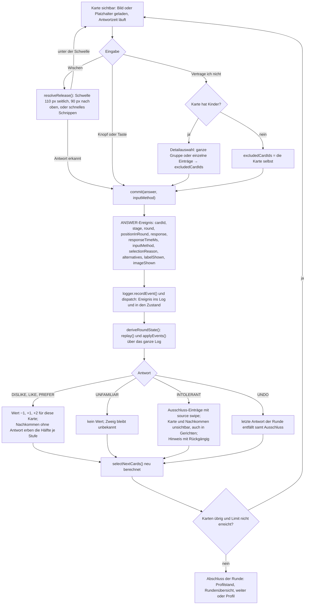
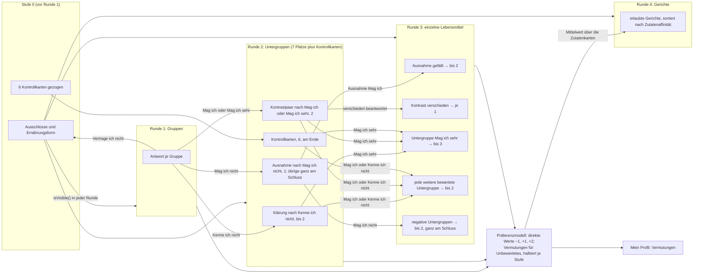
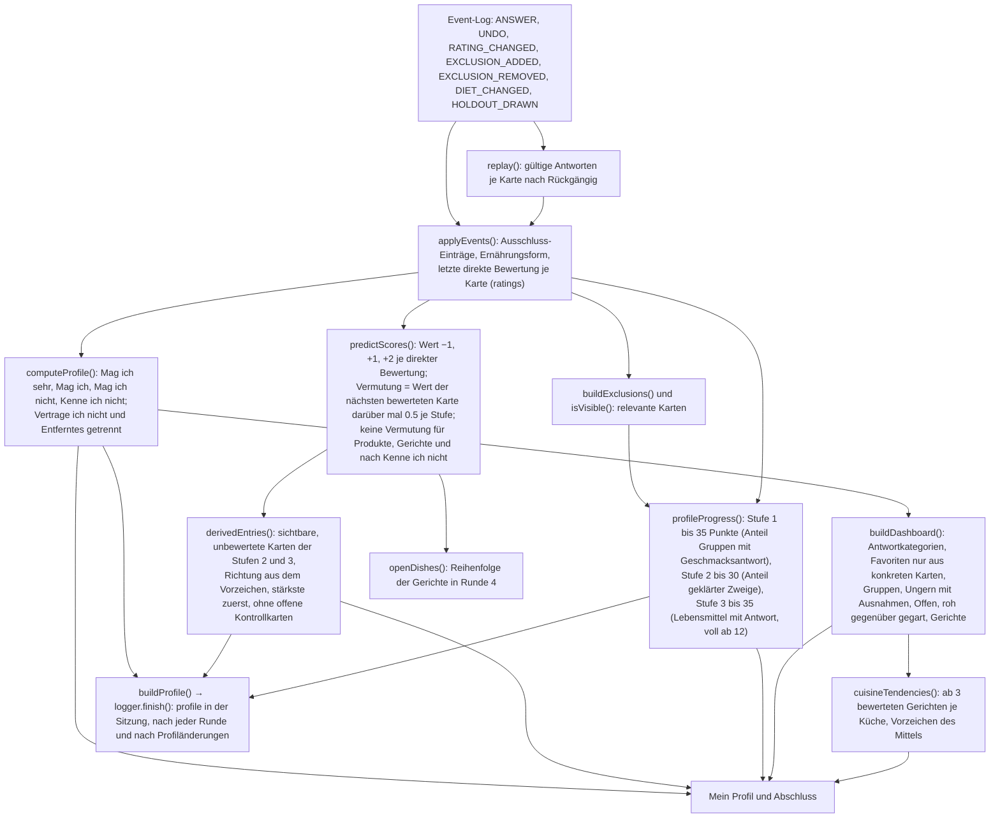

# 05 Flowcharts

Stand 26.10.2026, aus dem Code abgeleitet (Regeln `demo-0.6`). Alle Diagramme sind Mermaid-Flowcharts und wurden mit dem Mermaid-Parser (Version 11.17) auf Gültigkeit geprüft. GitHub, VS Code (mit Mermaid-Erweiterung) und die meisten Markdown-Werkzeuge rendern sie direkt. Jedes Diagramm nennt die Codestellen, die es abbildet.

## Diagramm A: Gesamtablauf der Anwendung

Code: `src/app/model.js → reducer()`, `src/App.jsx`, `src/logic/engine.js → nextRoundNumber()`.

Hinweise: „Runde beenden“ ist in jeder Runde möglich und führt zum Abschluss (Ereignis `QUESTION_ABORTED`); eine begonnene Runde lässt sich vom Abschluss aus fortsetzen, solange in einer späteren Runde noch nichts beantwortet ist (`canResumeRound()`). Ein gespeicherter Stand führt beim nächsten Öffnen zu „Willkommen zurück“ und dann an die gleiche Stelle.

## Diagramm B: Karten-Auswahlalgorithmus (technisch)

Code: `src/logic/engine.js → selectNextCards()`, `openDishes()`, `openHoldout()`; `src/logic/selection.js → rankedStageCards()`, `rankedCards()`, `balance()`, `interleave()`; `src/logic/filter.js → isVisible()`.

## Diagramm B (vereinfacht): Was in welcher Runde kommt

## Diagramm C: Verarbeitung einer Swipe-Entscheidung

Code: `src/components/SwipeCard.jsx`, `src/logic/swipe.js → resolveRelease()`, `src/screens/RoundScreen.jsx → handleCommitted()`, `handleIntolerant()`, `src/App.jsx → record()`, `src/logic/engine.js → replay()`, `applyEvents()`.

## Diagramm D: Zusammenspiel der Runden

Zeigt, welche Antwort einer Runde welche Karten der nächsten Runde auslöst. Code: `src/logic/selection.js → rankedCards()`, `rankedStageCards()`; `src/logic/engine.js → openDishes()`; `src/logic/preferences.js`.

Lesebeispiel: Obst „Sehr gern“ in Runde 1 löst in Runde 2 das Kontrastpaar Beeren und Zitrusfrüchte aus. Beeren „Mag ich sehr“ und Zitrusfrüchte „Mag ich nicht“ lösen in Runde 3 Erdbeeren und Orangen aus (Kontrast verschieden), dazu bis zu zwei weitere Beeren (Favoriten). Kernobst, Steinobst und Tropisches Obst werden nur gefragt, wenn in Runde 2 noch Plätze frei sind, sonst nur vermutet. Was nie gefragt wurde, erreicht Runde 3 nicht.

## Diagramm E: Berechnung des Geschmacksprofils

Code: `src/logic/engine.js → replay()`, `applyEvents()`, `computeProfile()`, `derivedEntries()`, `buildProfile()`; `src/logic/preferences.js → predictScores()`; `src/logic/dashboard.js → profileProgress()`, `buildDashboard()`; `src/logic/cuisines.js`; `src/logging/logger.js → finish()`.

## Prüfung der Diagramme

Die sechs Diagramme wurden am 26.10.2026 mit `mermaid.parse()` (Mermaid 11.17.2 in Node mit jsdom) geprüft: alle gültig (`flowchart-v2`). Wer sie erneut prüfen will, kann das Mermaid Live Editor (mermaid.live) verwenden oder die Vorschau in VS Code.
